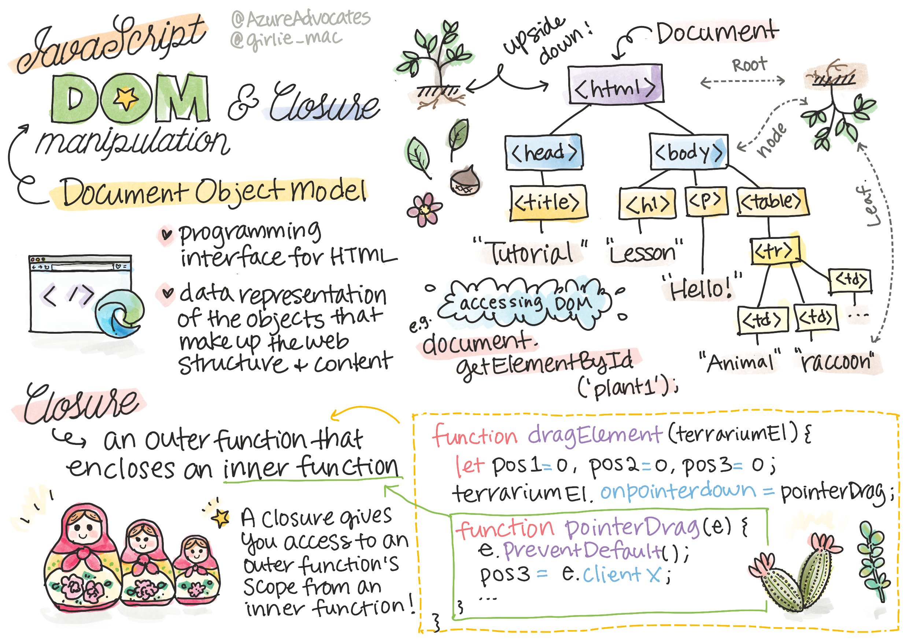
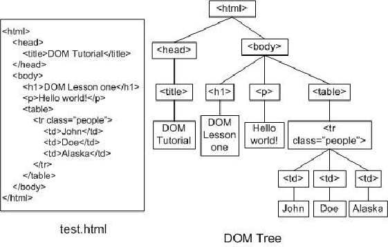
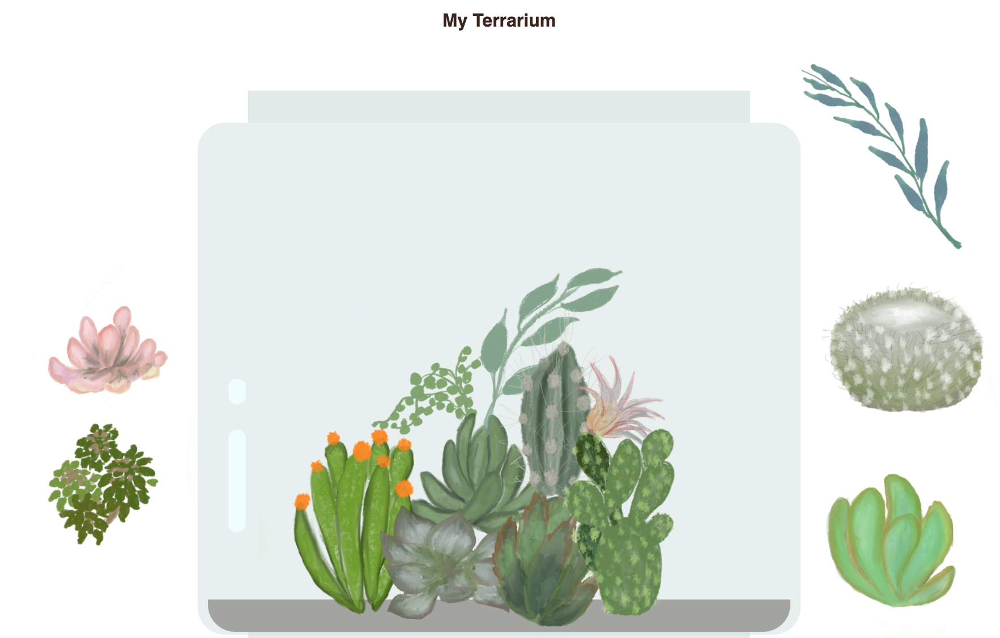

# Projet Terrarium Partie 3 : Manipulation du DOM et notion de closure (fermeture)


> Sketchnote par [Tomomi Imura](https://twitter.com/girlie_mac)

## Quiz préalable

[Quiz préalable](https://ff-quizzes.netlify.app/web/quiz/19?loc=fr)

### Introduction

La manipulation du DOM, ou "Document Object Model", est un aspect essentiel du développement web. Selon [MDN](https://developer.mozilla.org/docs/Web/API/Document_Object_Model/Introduction), "le Document Object Model (DOM) est la représentation des données des objets qui comprennent la structure et le contenu d'un document sur le Web". Les défis autour de la manipulation du DOM sur le web ont souvent été à l'origine de l'utilisation de frameworks JavaScript au lieu de vanilla JavaScript pour gérer le DOM, mais nous nous débrouillerons seuls !

En outre, cette leçon présente l'idée d'une [fermeture JavaScript](https://developer.mozilla.org/docs/Web/JavaScript/Closures), que vous pouvez considérer comme une fonction entourée d'une autre fonction, de sorte que la fonction interne ait accès à la portée de la fonction externe.

> Les fermetures JavaScript sont un sujet vaste et complexe. Cette leçon aborde l'idée la plus élémentaire : dans le code de ce terrarium, vous trouverez une fermeture : une fonction interne et une fonction externe construites de manière à permettre à la fonction interne d'accéder à la portée de la fonction externe. Pour de plus amples informations sur la façon dont cela fonctionne, veuillez consulter la [documentation approfondie](https://developer.mozilla.org/docs/Web/JavaScript/Closures).

Nous allons utiliser une fermeture pour manipuler le DOM.

Imaginez le DOM comme un arbre, représentant toutes les façons dont un document de page Web peut être manipulé. Diverses API (interfaces de programme d'application) ont été écrites pour que les programmeurs, en utilisant le langage de programmation de leur choix, puissent accéder au DOM et l'éditer, le modifier, le réorganiser et le gérer.



> Une représentation du DOM et du balisage HTML qui y fait référence. De [Olfa Nasraoui](https://www.researchgate.net/publication/221417012_Profile-Based_Focused_Crawler_for_Social_Media-Sharing_Websites)

Dans cette leçon, nous allons compléter notre projet de terrarium interactif en créant le JavaScript qui permettra à un utilisateur de manipuler les plantes sur la page.

### Pré-requis

Vous devriez avoir construit le HTML et le CSS de votre terrarium. À la fin de cette leçon, vous serez en mesure de faire entrer et sortir les plantes du terrarium en les faisant glisser.

### Tâche

Dans le dossier de votre terrarium, créez un nouveau fichier appelé `script.js`. Importez ce fichier dans la section `<head>` :

```html
	<script src="./script.js" defer></script>
```

> Remarque : utilisez l'attribut `defer` lors de l'importation d'un fichier JavaScript externe dans le fichier HTML afin de permettre au JavaScript de s'exécuter uniquement après le chargement complet du fichier HTML. Vous pourriez également utiliser l'attribut `async`, qui permet au script de s'exécuter pendant l'analyse du fichier HTML, mais dans notre cas, il est important que les éléments HTML soient entièrement disponibles pour le glisser avant de permettre l'exécution du script de glisser.
---

## Les éléments du DOM

La première chose à faire est de créer des références aux éléments que vous voulez manipuler dans le DOM. Dans notre cas, il s'agit des 14 plantes actuellement en attente dans les barres latérales.

### Tâche

```html
dragElement(document.getElementById('plant1'));
dragElement(document.getElementById('plant2'));
dragElement(document.getElementById('plant3'));
dragElement(document.getElementById('plant4'));
dragElement(document.getElementById('plant5'));
dragElement(document.getElementById('plant6'));
dragElement(document.getElementById('plant7'));
dragElement(document.getElementById('plant8'));
dragElement(document.getElementById('plant9'));
dragElement(document.getElementById('plant10'));
dragElement(document.getElementById('plant11'));
dragElement(document.getElementById('plant12'));
dragElement(document.getElementById('plant13'));
dragElement(document.getElementById('plant14'));
```

Que se passe-t-il ici ? Vous faites référence au document et cherchez dans son DOM un élément avec un Id particulier. Vous vous souvenez que dans la première leçon sur le HTML, vous avez donné des Ids individuels à chaque image de plante (`id="plant1"`) ? Vous allez maintenant mettre à profit cet effort. Après avoir identifié chaque élément, vous passez cet élément à une fonction appelée `dragElement` que vous allez construire dans une minute. Ainsi, l'élément dans le HTML est maintenant capable de glisser, ou le sera bientôt.

✅ Pourquoi référençons-nous les éléments par leur Id ? Pourquoi pas par leur classe CSS ? Vous pouvez vous référer à la leçon précédente sur les CSS pour répondre à cette question.

---

## La fermeture

Vous êtes maintenant prêt à créer la fermeture dragElement, qui est une fonction externe entourant une ou plusieurs fonctions internes (dans notre cas, nous en aurons trois). 

Les fermetures sont utiles lorsqu'une ou plusieurs fonctions doivent accéder à la portée d'une fonction externe. Voici un exemple :

```javascript
function displayCandy(){
	let candy = ['jellybeans'];
	function addCandy(candyType) {
		candy.push(candyType)
	}
	addCandy('gumdrops');
}
displayCandy();
console.log(candy)
```

Dans cet exemple, la fonction displayCandy entoure une fonction qui pousse un nouveau type de bonbon dans un tableau qui existe déjà dans la fonction. Si vous deviez exécuter ce code, le tableau `candy` serait indéfini, car il s'agit d'une variable locale (locale à la fermeture). 

✅ Comment pouvez-vous rendre le tableau `candy` accessible ? Essayez de le déplacer à l'extérieur de la fermeture. De cette façon, le tableau devient global, plutôt que de rester uniquement disponible à la portée locale de la fermeture.

### Tâche

Sous les déclarations d'éléments dans `script.js`, créez une fonction :

```javascript
function dragElement(terrariumElement) {
	// Définir 4 positions pour le positionnement sur l'écran
	let pos1 = 0,
		pos2 = 0,
		pos3 = 0,
		pos4 = 0;
	terrariumElement.onpointerdown = pointerDrag;
}
```

`dragElement` obtient son objet `terrariumElement` à partir des déclarations en haut du script. Ensuite, vous définissez quelques positions locales à `0` pour l'objet passé dans la fonction. Ce sont les variables locales qui seront manipulées pour chaque élément au fur et à mesure que vous ajouterez la fonctionnalité de glisser-déposer dans la fermeture à chaque élément. Le terrarium sera peuplé par ces éléments glissés, l'application doit donc garder la trace de l'endroit où ils sont placés.

En outre, l'élément terrariumElement qui est passé à cette fonction se voit attribuer un événement `pointerdown`, qui fait partie des [web APIs](https://developer.mozilla.org/docs/Web/API) conçus pour aider à la gestion du DOM. L'événement `onpointerdown` se déclenche lorsqu'on appuie sur un bouton ou, dans notre cas, lorsqu'on touche un élément glissant. Ce gestionnaire d'événements fonctionne à la fois sur les [navigateurs Web et mobiles](https://caniuse.com/?search=onpointerdown), à quelques exceptions près.

✅ Le [gestionnaire d'événement `onclick`](https://developer.mozilla.org/docs/Web/API/GlobalEventHandlers/onclick) est bien mieux supporté par les différents navigateurs ; pourquoi ne l'utiliseriez-vous pas ici ? Pensez au type exact d'interaction à l'écran que vous essayez de créer ici.

---

## La fonction Pointerdrag

Le terrariumElement est prêt à être déplacé ; lorsque l'événement `onpointerdown` est déclenché, la fonction pointerDrag est invoquée. Ajoutez cette fonction juste sous cette ligne : `terrariumElement.onpointerdown = pointerDrag;` :

### Tâche 

```javascript
function pointerDrag(e) {
	e.preventDefault();
	console.log(e);
	pos3 = e.clientX;
	pos4 = e.clientY;
}
```

Plusieurs choses se produisent. Premièrement, vous empêchez les événements par défaut qui se produisent normalement lors d'un pointeur vers le bas de se produire en utilisant `e.preventDefault();`. De cette façon, vous avez plus de contrôle sur le comportement de l'interface.

> Revenez à cette ligne lorsque vous avez construit le fichier de script complètement et essayez-le sans `e.preventDefault()` - que se passe-t-il ?

Ensuite, ouvrez `index.html` dans une fenêtre du navigateur, et inspectez l'interface. Lorsque vous cliquez sur une plante, vous pouvez voir comment l'événement 'e' est capturé. Creusez dans l'événement pour voir combien d'informations sont recueillies par un événement de type "pointeur vers le bas" ! 

Ensuite, notez comment les variables locales `pos3` et `pos4` sont définies sur e.clientX. Vous pouvez trouver les valeurs `e` dans le volet d'inspection. Ces valeurs capturent les coordonnées x et y de la plante au moment où vous cliquez dessus ou la touchez. Vous aurez besoin d'un contrôle précis sur le comportement des plantes lorsque vous cliquerez dessus et les ferez glisser, afin de garder une trace de leurs coordonnées.

✅ On comprend mieux pourquoi toute cette application est construite avec une seule grosse fermeture ? Si ce n'était pas le cas, comment maintiendriez-vous la portée de chacune des 14 plantes glissantes ?

Complétez la fonction initiale en ajoutant deux autres manipulations d'événements de pointeurs sous `pos4 = e.clientY` :

```html
document.onpointermove = elementDrag;
document.onpointerup = stopElementDrag;
```
Vous indiquez maintenant que vous voulez que la plante soit déplacée avec le pointeur lorsque vous la déplacez, et que le geste de déplacement s'arrête lorsque vous désélectionnez la plante. `onpointertermove` et `onpointerup` font partie de la même API que `onpointerdown`. L'interface lancera des erreurs maintenant car vous n'avez pas encore défini les fonctions `elementDrag` et `stopElementDrag`, donc construisez-les ensuite.

## Les fonctions elementDrag et stopElementDrag

Vous compléterez votre fermeture en ajoutant deux autres fonctions internes qui géreront ce qui se passe lorsque vous faites glisser une plante et que vous arrêtez de la faire glisser. Le comportement que vous souhaitez est que vous puissiez glisser n'importe quelle plante à tout moment et la placer n'importe où sur l'écran. Cette interface est assez libre (il n'y a pas de zone de dépôt par exemple) pour vous permettre de concevoir votre terrarium exactement comme vous le souhaitez en ajoutant, en retirant et en repositionnant les plantes.

### Tâche

Ajoutez la fonction `elementDrag` juste après le crochet fermant de `pointerDrag` :

```javascript
function elementDrag(e) {
	pos1 = pos3 - e.clientX;
	pos2 = pos4 - e.clientY;
	pos3 = e.clientX;
	pos4 = e.clientY;
	console.log(pos1, pos2, pos3, pos4);
	terrariumElement.style.top = terrariumElement.offsetTop - pos2 + 'px';
	terrariumElement.style.left = terrariumElement.offsetLeft - pos1 + 'px';
}
```
Dans cette fonction, vous effectuez de nombreuses modifications des positions initiales 1-4 que vous avez définies comme variables locales dans la fonction externe. Que se passe-t-il ici ?

En glissant, vous réassignez `pos1` en le rendant égal à `pos3` (que vous avez défini précédemment comme `e.clientX`) moins la valeur actuelle de `e.clientX`. Vous effectuez une opération similaire pour `pos2`. Ensuite, vous réinitialisez `pos3` et `pos4` aux nouvelles coordonnées X et Y de l'élément. Vous pouvez observer ces changements dans la console pendant que vous faites glisser l'élément. Ensuite, vous manipulez le style css de la plante pour définir sa nouvelle position en fonction des nouvelles positions de `pos1` et `pos2`, en calculant les coordonnées X et Y du haut et de la gauche de la plante en comparant son décalage avec ces nouvelles positions.

> `offsetTop` et `offsetLeft` sont des propriétés CSS qui définissent la position d'un élément en fonction de celle de son parent ; son parent peut être n'importe quel élément qui n'est pas positionné comme `static`. 

Tous ces recalculs de positionnement permettent d'affiner le comportement du terrarium et de ses plantes.

### Tâche

La dernière tâche pour compléter l'interface est d'ajouter la fonction `stopElementDrag` après l'accolade de fermeture de `elementDrag` :

```javascript
function stopElementDrag() {
	document.onpointerup = null;
	document.onpointermove = null;
}
```

Cette petite fonction réinitialise les événements `onpointerup` et `onpointermove` afin que vous puissiez soit relancer la progression de votre plante en recommençant à la faire glisser, soit commencer à faire glisser une nouvelle plante.

✅ Que se passe-t-il si vous ne mettez pas ces événements à zéro ?

Vous avez maintenant terminé votre projet !

🥇Félicitations ! Tu as terminé ton magnifique terrarium. 

---

## 🚀 Défi

Ajoutez un nouveau gestionnaire d'événements à votre fermeture pour faire quelque chose de plus aux plantes ; par exemple, double-cliquez sur une plante pour la mettre en avant. Soyez créatif !

## Quiz de validation des connaissances

[Quiz de validation des connaissances](https://ff-quizzes.netlify.app/web/quiz/20?loc=fr)

## Examen et étude personnelle

Si faire glisser des éléments à l'écran semble trivial, il existe de nombreuses façons de le faire et de nombreux pièges, en fonction de l'effet recherché. En fait, il existe toute une [API de glisser-déposer](https://developer.mozilla.org/docs/Web/API/HTML_Drag_and_Drop_API) que vous pouvez essayer. Nous ne l'avons pas utilisée dans ce module car l'effet recherché était quelque peu différent, mais essayez cette API sur votre propre projet et voyez ce que vous pouvez réaliser.

Vous trouverez plus d'informations sur les événements liés aux pointeurs sur le site [W3C docs](https://www.w3.org/TR/pointerevents1/) et sur le site [MDN web docs](https://developer.mozilla.org/docs/Web/API/Pointer_events).

Vérifiez toujours les capacités du navigateur en utilisant [CanIUse.com](https://caniuse.com/).

## Affectation

[Travailler un peu plus avec le DOM](assignment.fr.md)

