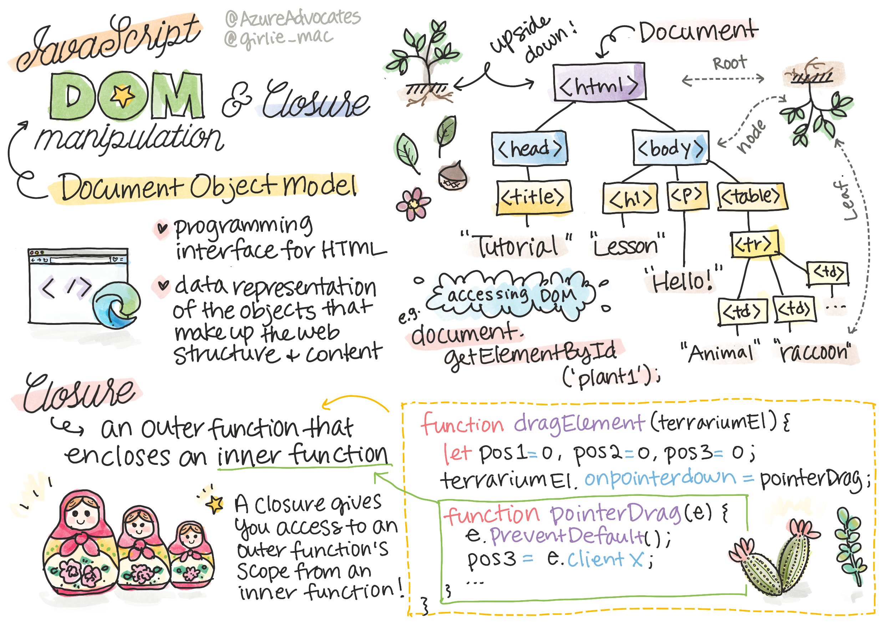
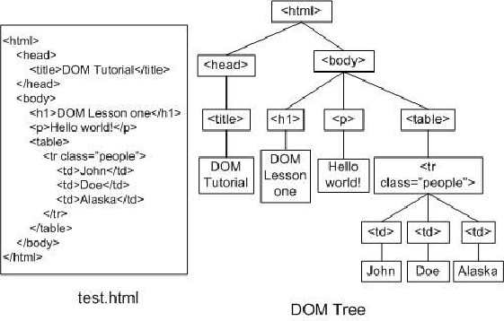
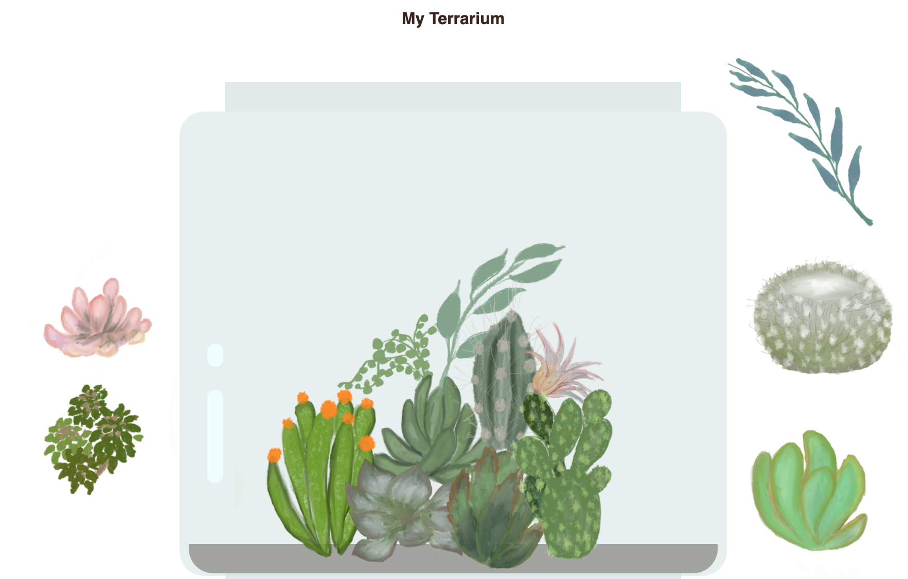

# Progetto Terrario Parte 3: Manipolazione del DOM e Closure


> Sketchnote di [Tomomi Imura](https://twitter.com/girlie_mac)

## Quiz Pre-Lezione

[Quiz Pre-Lezione](https://ff-quizzes.netlify.app/web/quiz/19?loc=it)

### Introduzione

La manipolazione del DOM, acronimo per "Document Object Model", è un aspetto chiave dello sviluppo web. Secondo [MDN](https://developer.mozilla.org/docs/Web/API/Document_Object_Model/Introduction), "Il Document Object Model (DOM) è la rappresentazione dei dati degli oggetti che compongono la struttura e il contenuto di un documento sul web". Le sfide intorno alla manipolazione del DOM sul Web sono state spesso l'impulso dietro l'utilizzo di infrastrutture (framework) JavaScript invece di JavaScript puro (vanilla) per gestire il DOM, ma ce la faremo da soli!

Inoltre, questa lezione introdurrà l'idea di una [closure JavaScript](https://developer.mozilla.org/docs/Web/JavaScript/Closures), che si può intendere come una funzione racchiusa da un'altra funzione in modo che la funzione più interna abbia accesso all'ambito della funzione più esterna.

> Le closure JavaScript sono un argomento vasto e complesso. Questa lezione tocca l'idea più basilare che nel codice di questo terrario si troverà una closure: una funzione interna e una funzione esterna costruite in modo da consentire alla funzione interna di accedere all'ambito della funzione esterna. Per molte più informazioni su come funziona, visitare l'[ampia documentazione](https://developer.mozilla.org/docs/Web/JavaScript/Closures).

Verra usata una closure per manipolare il DOM.

Si pensi al DOM come a un albero, che rappresenta tutti i modi in cui un documento di una pagina web può essere manipolato. Sono state scritte varie API (Application Program Interfaces) in modo che i programmatori, utilizzando linguaggio di programmazione di propria scelta, possano accedere al DOM e modificarlo, cambiarlo, riorganizzarlo e gestirlo in altro modo.



> Una rappresentazione del DOM e del markup HTML che lo indirizza Da [Olfa Nasraoui](https://www.researchgate.net/publication/221417012_Profile-Based_Focused_Crawler_for_Social_Media-Sharing_Websites)

In questa lezione, verrà completato il progetto di terrario interattivo creando il codice JavaScript che consentirà a un utente di manipolare le piante sulla pagina.

### Pre-requisiti

Si dovrebbe avere il codice HTML e CSS per il proprio terrario costruito. Alla fine di questa lezione si sarà in grado di spostare le piante dentro e fuori dal terrario trascinandole.

### Attività

Nella cartella terrarium, creare un nuovo file chiamato `script.js`. Importare quel file nella sezione  `<head>`:

```html
	<script src="./script.js" defer></script>
```

> Nota: utilizzare `defer` quando si importa un file JavaScript esterno nel file html in modo da consentire l'esecuzione di JavaScript solo dopo che il file HTML è stato completamente caricato. È anche possibile utilizzare l'attributo `async`, che consente l'esecuzione dello script durante l'analisi del file HTML, ma in questo caso, è importante avere gli elementi HTML completamente disponibili per il trascinamento prima di consentire l'esecuzione dello script di trascinamento.
---

## Gli elementi DOM

La prima cosa da fare è creare i riferimenti agli elementi che si vogliono manipolare nel DOM. Nel nostro caso, sono le 14 piante attualmente in attesa nelle barre laterali.

### Attività

```javascript
dragElement(document.getElementById('plant1'));
dragElement(document.getElementById('plant2'));
dragElement(document.getElementById('plant3'));
dragElement(document.getElementById('plant4'));
dragElement(document.getElementById('plant5'));
dragElement(document.getElementById('plant6'));
dragElement(document.getElementById('plant7'));
dragElement(document.getElementById('plant8'));
dragElement(document.getElementById('plant9'));
dragElement(document.getElementById('plant10'));
dragElement(document.getElementById('plant11'));
dragElement(document.getElementById('plant12'));
dragElement(document.getElementById('plant13'));
dragElement(document.getElementById('plant14'));
```

Cosa sta succedendo qui? Si sta referenziando il documento e guardando attraverso il suo DOM per trovare un elemento con un ID particolare. Si ricorda nella prima lezione sull'HTML che sono stati forniti ID individuali a ciascuna immagine della pianta (`id = "plant1"`)? Ora si farà uso di quello sforzo. Dopo aver identificato ogni elemento, lo si passi a una funzione chiamata `dragElement` che verrà creata a breve. Quindi l'elemento nell'HTML è ora abilitato al trascinamento, o lo sarà a breve.

✅ Perché gli elementi vengono referenziati in base al loro Id? Perché non la loro classe CSS? Si può fare riferimento alla lezione precedente su CSS per rispondere a questa domanda.

---

## Closure

Ora si è pronti per creare la closure dragElement, che è una funzione esterna che racchiude una o più funzioni interne (nel nostro caso, ne avremo tre).

Le closure sono utili quando una o più funzioni devono accedere all'ambito di una funzione più esterna. Ecco un esempio:

```javascript
function displayCandy(){
	let candy = ['jellybeans'];
	function addCandy(candyType) {
		candy.push(candyType)
	}
	addCandy('gumdrops');
}
displayCandy();
console.log(candy)
```

In questo esempio, la funzione displayCandy circonda una funzione che inserisce un nuovo tipo di caramella in una matrice già esistente nella funzione. Se si dovesse eseguire questo codice, l'array `candy` non sarebbe definito, poiché è una variabile locale (locale alla closure).

✅ Come si può rendere accessibile l'array `candy`? Si provi a spostarlo fuori dalla closure. In questo modo, l'array diventa globale, anziché rimanere disponibile solo per l'ambito locale della closure.

### Attività

Sotto le dichiarazioni degli elementi in `script.js`, creare una funzione:

```javascript
function dragElement(terrariumElement) {
	//imposta 4 posizioni per il posizionamento sullo schermo
	let pos1 = 0,
		pos2 = 0,
		pos3 = 0,
		pos4 = 0;
	terrariumElement.onpointerdown = pointerDrag;
}
```

`dragElement` ottiene il suo oggetto `terrariumElement` dalle dichiarazioni nella parte superiore dello script. Quindi, si impostano alcune posizioni locali su `0` per l'oggetto passato alla funzione. Queste sono le variabili locali che verranno manipolate per ogni elemento quando si aggiunge la funzionalità di trascinamento all'interno della closure a ciascun elemento. Il terrario sarà popolato da questi elementi trascinati, quindi l'applicazione deve tenere traccia di dove sono posizionati.

Inoltre, al terrariumElement passato a questa funzione viene assegnato un  evento di riconoscimento pressione pulsante (`pointerdown`), che fa parte delle [API web](https://developer.mozilla.org/it/docs/Web/API) progettate per aiutare con la gestione del DOM. `onpointerdown` si attiva quando viene premuto un pulsante o, in questo caso, viene toccato un elemento trascinabile. Questo gestore di evento funziona sia su browser [web che su browser di dispositivi mobili](https://caniuse.com/?search=onpointerdown), con poche eccezioni.

✅ Il [gestore di evento `onclick`](https://developer.mozilla.org/docs/Web/API/GlobalEventHandlers/onclick) ha molto più supporto intra-browser; perché non viene usato qui? Si pensi al tipo esatto di interazione con lo schermo che si sta cercando di creare qui.

---

## La funzione Pointerdrag

Il terrariumElement è pronto per essere trascinato in giro; quando viene generato l'evento `onpointerdown`, viene richiamata la funzione pointerDrag. Aggiungere quella funzione proprio sotto questa riga: `terrariumElement.onpointerdown = pointerDrag;`:

### Attività

```javascript
function pointerDrag(e) {
	e.preventDefault();
	console.log(e);
	pos3 = e.clientX;
	pos4 = e.clientY;
}
```

Succedono molte cose. Innanzitutto, si impedisce che si verifichino gli eventi predefiniti che normalmente si verificano su pointerdown utilizzando `e.preventDefault();`. In questo modo si ha un maggiore controllo sul comportamento dell'interfaccia.

> Tornare su questa riga quando si è costruito completamente il file di script e provarlo senza `e.preventDefault()` - cosa succede?

Secondo, aprire `index.html` in una finestra del browser e controllare l'interfaccia. Quando si fa clic su una pianta, puoi vedere come viene catturato l'evento "e". Analizzare l'evento per vedere quante informazioni vengono raccolte da un evento pointerdown!

Successivamente, notare come le variabili locali `pos3` e `pos4` sono impostate su e.clientX. È possibile trovare i valori di `e` nel riquadro di ispezione. Questi valori catturano le coordinate x e y della pianta nel momento in cui si fa clic su di essa o si tocca. Si avrà bisogno di un controllo preciso sul comportamento delle piante mentre si fa clic e si trascinano, in modo da tenere traccia delle loro coordinate.

✅ Sta diventando più chiaro il motivo per cui l'intera app è costruita con un'unica grande closure? Se non lo fosse, come si manterrebbe l'ambito di ciascuna delle 14 piante trascinabili?

Completare la funzione iniziale aggiungendo altre due manipolazioni di eventi del puntatore sotto `pos4 = e.clientY`:

```html
document.onpointermove = elementDrag;
document.onpointerup = stopElementDrag;
```
Ora si sta indicando che si vuole che la pianta venga trascinata insieme al puntatore mentre lo si muove e che il gesto di trascinamento si interrompa quando si deseleziona la pianta. `onpointermove` e `onpointerup` sono tutte parti della stessa API come `onpointerdown`. L'interfaccia genererà errori ora poiché non si sono ancora definite le funzioni `elementDrag` e `stopElementDrag`, quindi verranno create successivamente.

## Le funzioni elementDrag e stopElementDrag

La closure verrà completata aggiungendo altre due funzioni interne che gestiranno ciò che accade quando si trascina una pianta e si smette di trascinarla. Il comportamento desiderato è che si possa trascinare qualsiasi pianta in qualsiasi momento e posizionarla ovunque sullo schermo. Questa interfaccia è abbastanza rigida (non esiste una zona di rilascio, ad esempio) per consentire di progettare il proprio terrario esattamente come si preferisce aggiungendo, rimuovendo e riposizionando le piante.

### Attività

Aggiungere la funzione `elementDrag` subito dopo la parentesi graffa di chiusura di `pointerDrag`:

```javascript
function elementDrag(e) {
	pos1 = pos3 - e.clientX;
	pos2 = pos4 - e.clientY;
	pos3 = e.clientX;
	pos4 = e.clientY;
	console.log(pos1, pos2, pos3, pos4);
	terrariumElement.style.top = terrariumElement.offsetTop - pos2 + 'px';
	terrariumElement.style.left = terrariumElement.offsetLeft - pos1 + 'px';
}
```
In questa funzione, si faranno molte modifiche alle posizioni iniziali 1-4 che verranno impostate come variabili locali nella funzione esterna. Cosa sta succedendo qui?

Mentre si trascina, `pos1` viene riassegnato rendendolo uguale a `pos3` (che precedenza si è impostato come `e.clientX`) meno il valore corrente di `e.clientX`. Eseguire un'operazione simile per `pos2`. Quindi, reimpostare `pos3` e `pos4` sulle nuove coordinate X e Y dell'elemento. E' possibile monitorare questi cambiamenti nella console mentre si trascina. Quindi, è stato manipolato lo stile css della pianta per impostare la sua nuova posizione in base alle nuove posizioni di `pos1` e `pos2`, calcolando le coordinate X e Y superiore e sinistra della pianta in base al confronto del suo scostamento con queste nuove posizioni.

> `offsetTop` e `offsetLeft` sono proprietà CSS che impostano la posizione di un elemento in base a quella del suo genitore; il suo genitore può essere qualsiasi elemento che non è posizionato come `static`.

Tutto questo ricalcolo del posizionamento consente di mettere a punto il comportamento del terrario e delle sue piante.

### Attività

Il compito finale per completare l'interfaccia è aggiungere la funzione `stopElementDrag` dopo la parentesi graffa di chiusura di `elementDrag`:

```javascript
function stopElementDrag() {
	document.onpointerup = null;
	document.onpointermove = null;
}
```

Questa piccola funzione reimposta gli eventi `onpointerup` e `onpointermove` in modo che si possa riavviare il progresso della pianta iniziando a trascinarla di nuovo, o iniziare a trascinare una nuova pianta.

✅ Cosa succede se non si impostano questi eventi su null?

Ora tsdi è completato il progetto!

🥇Congratulazioni! Il meraviglioso terrario è finito

---

## 🚀 Sfida

Aggiungere un nuovo gestore di eventi alla closure per fare qualcosa di più con le piante; ad esempio, fare doppio clic su una pianta per portarla in primo piano. Si dia sfogo alla propria creatività!

## Quiz Post-Lezione

[Quiz post-lezione](https://ff-quizzes.netlify.app/web/quiz/20?loc=it)

## Revisione e Auto Apprendimento

Mentre trascinare elementi sullo schermo sembra banale, ci sono molti modi per farlo e molte insidie, a seconda dell'effetto che si cerca. In effetti, esiste un'intera [API di trascinamento della selezione](https://developer.mozilla.org/docs/Web/API/HTML_Drag_and_Drop_API) che si può provare. Non è stata usata in questo modulo perché l'effetto che si voleva era leggermente diverso, tuttavia provare questa API sul proprio progetto per vedere cosa si può ottenere.

Trovare ulteriori informazioni sugli eventi di puntamento nei [documenti W3C](https://www.w3.org/TR/pointerevents1/) e nei [documenti Web MDN](https://developer.mozilla.org/docs/Web/API/Pointer_events).

Controllare sempre le funzionalità del browser utilizzando [CanIUse.com](https://caniuse.com/).

## Compito

[Lavorare un po' di più con il DOM](assignment.it.md)

