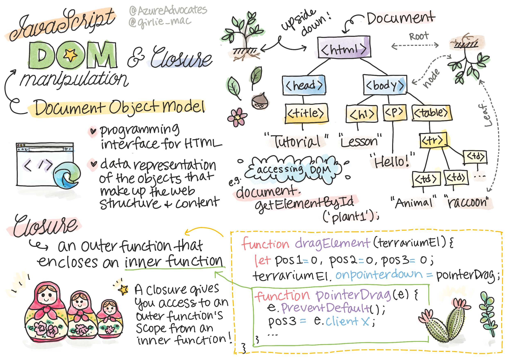
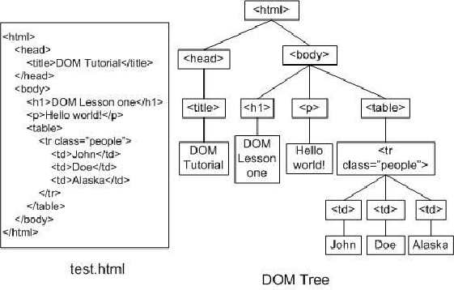
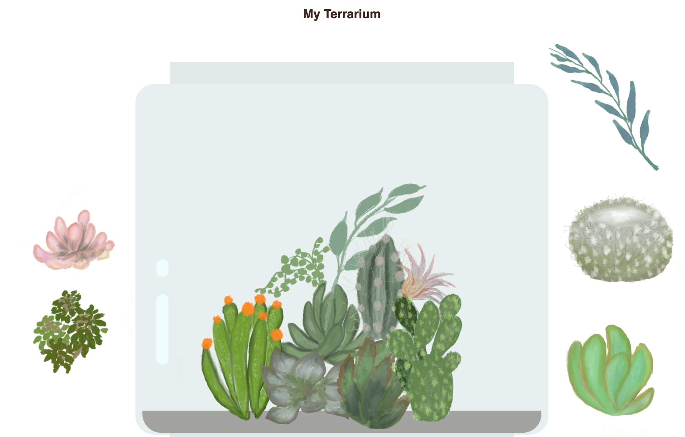

# Projeto Terrarium Parte 3:  Manipulação do DOM e fechamento


> Esboço de [Tomomi Imura](https://twitter.com/girlie_mac)

## Quiz pré-leitura 

[Quiz pré-leitura](https://ff-quizzes.netlify.app/web/quiz/19)


### Introdução

Manipular o DOM, ou o "Modelo de objeto de documento", é um aspecto chave do desenvolvimento web. Segundo [MDN](https://developer.mozilla.org/pt-BR/docs/Web/API/Document_Object_Model/Introduction), "O DOM (Document Object Model) é a representação de dados dos objetos que compõem a estrutura e o conteúdo de um documento na Web.". Os desafios em torno da manipulação do DOM na web, muitas vezes tem sido o ímpeto por trás do uso de frameworks JavaScript em vez de JavaScript vanilla para gerenciar o DOM, mas vamos gerenciar por conta própria!!

Além disso, essa lição apresentará a ideia de um [closure(encerramento) de JavaScript](https://developer.mozilla.org/docs/Web/JavaScript/Closures), que você pode considerar como uma função delimitada por outra função, de modo que a função interna tenha acesso ao escopo da função externa.

> Os closures (fechamentos) de JavaScript são um tópico vasto e complexo. Esta lição toca na ideia mais básica de que no código deste terrário, você encontrará um closure: uma função interna e uma função externa construída de forma a permitir que a função interna acesse o escopo da função externa. Para obter mais informações sobre como isso funciona, visite a [extensa documentação](https://developer.mozilla.org/docs/Web/JavaScript/Closures).

Usaremos um closure para manipular o DOM.

Pense no DOM como uma árvore, representando todas as maneiras como um documento de página da web pode ser manipulado. Várias APIs (interfaces de programa de aplicativo) foram escritas para que os programadores, usando sua linguagem de programação de escolha, possam acessar o DOM e editar, alterar, reorganizar e de outra forma gerenciá-lo.



> Uma representação do DOM e a marcação HTML que faz referência a ele. De [Olfa Nasraoui](https://www.researchgate.net/publication/221417012_Profile-Based_Focused_Crawler_for_Social_Media-Sharing_Websites)

Nesta lição, concluiremos nosso projeto de terrário interativo criando o JavaScript que permitirá ao usuário manipular as plantas na página.

### Pré-requisitos

Você deve ter construído o HTML e CSS para o seu terrário. Ao final desta lição, você será capaz de mover as plantas para dentro e para fora do terrário arrastando-as.

### Tarefa


Na pasta do seu terrário, crie um novo arquivo chamado script.js. Importe esse arquivo na seção `<head>`:


```html
	<script src="./script.js" defer></script>
```

> Nota: use `defer` ao importar um arquivo JavaScript externo para o arquivo html, de modo a permitir que o JavaScript seja executado somente depois que o arquivo HTML tiver sido totalmente carregado. Você também pode usar o atributo async, que permite que o script seja executado enquanto o arquivo HTML está sendo analisado, mas, em nosso caso, é importante ter os elementos HTML totalmente disponíveis para arrastar antes de permitir que o script de arrastar seja executado.

---

## Os elementos DOM

A primeira coisa que você precisa fazer é criar referências aos elementos que deseja manipular no DOM. No nosso caso, são as 14 plantas que aguardam atualmente nas barras laterais.


### Tarefa

```html
dragElement(document.getElementById('plant1'));
dragElement(document.getElementById('plant2'));
dragElement(document.getElementById('plant3'));
dragElement(document.getElementById('plant4'));
dragElement(document.getElementById('plant5'));
dragElement(document.getElementById('plant6'));
dragElement(document.getElementById('plant7'));
dragElement(document.getElementById('plant8'));
dragElement(document.getElementById('plant9'));
dragElement(document.getElementById('plant10'));
dragElement(document.getElementById('plant11'));
dragElement(document.getElementById('plant12'));
dragElement(document.getElementById('plant13'));
dragElement(document.getElementById('plant14'));
```

O que está acontecendo aqui? Você está referenciando o documento e olhando através de seu DOM para encontrar um elemento com um Id específico. Lembra na primeira lição sobre HTML que você deu Ids individuais para cada imagem de planta (id = "plant1")? Agora você fará uso disso. Depois de identificar cada elemento, você passa esse item para uma função chamada dragElement que construirá em um minuto. Portanto, o elemento no HTML agora está ativado para arrastar, ou será em breve.

✅ Por que referenciamos elementos por Id? Por que não por sua classe CSS? Você pode consultar a lição anterior sobre CSS para responder a esta pergunta.

---

## O Closure(fechamento)

Agora você está pronto para criar o closure(fechamento) dragElement, que é uma função externa que inclui uma função ou funções internas (em nosso caso, teremos três).

Os closures(fechamentos) são úteis quando uma ou mais funções precisam acessar o escopo de uma função externa. Aqui está um exemplo:

```javascript
function mostrarDoce(){
	let doce = ['jujubas'];
	function adicionarDoce(tipoDeDoce) {
		doce.push(tipoDeDoce)
	}
	adicionarDoce('gomas');
}
mostrarDoce();
console.log(doce)
```

Neste exemplo, a função mostrarDoce envolve uma função que coloca um novo tipo de doce em uma matriz que já existe na função. Se você executasse este código, o array doce seria indefinido, pois é uma variável local (local para o fechamento).

✅ Como você pode tornar o conjunto de doces acessível? Tente movê-lo para fora do fechamento. Dessa forma, o array torna-se global, ao invés de ficar disponível apenas para o escopo local do fechamento.

### Tarefa

Nas declarações de elemento em `script.js`, crie uma função:


```javascript
function dragElement(terrariumElement) {
	//definir 4 posições para posicionamento na tela
	let pos1 = 0,
		pos2 = 0,
		pos3 = 0,
		pos4 = 0;
	terrariumElement.onpointerdown = pointerDrag;
}
```

`dragElement` obtém seu objeto `terrariumElement` das declarações na parte superior do script. Em seguida, você define algumas posições locais em 0 para o objeto passado para a função. Essas são as variáveis ​​locais que serão manipuladas para cada elemento à medida que você adiciona a funcionalidade de arrastar e soltar no fechamento de cada elemento. O terrário será preenchido por esses elementos arrastados, então o aplicativo precisa manter o controle de onde eles são colocados.

Além disso, o terrariumElement que é passado para essa função é atribuído a um evento pointerdown, que faz parte das [APIs da web](https://developer.mozilla.org/docs/Web/API) projetadas para ajudar no gerenciamento de DOM. `Onpointerdown` dispara quando um botão é pressionado ou, em nosso caso, um elemento arrastável é tocado. Este manipulador de eventos funciona em [navegadores web e mobile](https://caniuse.com/?search=onpointerdown), com algumas exceções.

✅ O [manipulador de eventos onclick](https://developer.mozilla.org/docs/Web/API/GlobalEventHandlers/onclick) tem muito mais suporte para vários navegadores; por que você não usaria aqui? Pense no tipo exato de interação de tela que você está tentando criar aqui.

---

## A função Pointerdrag

O terrariumElement está pronto para ser arrastado; quando o evento `onpointerdown` é disparado, a função `pointerDrag` é chamada. Adicione essa função logo abaixo desta linha: `terrariumElement.onpointerdown = pointerDrag;`:

### Tarefa

```javascript
function pointerDrag(e) {
	e.preventDefault();
	console.log(e);
	pos3 = e.clientX;
	pos4 = e.clientY;
}
```


Várias coisas acontecem. Primeiro, você evita que os eventos padrão que normalmente acontecem em pointerdown ocorram usando `e.preventDefault ();`. Dessa forma, você tem mais controle sobre o comportamento da interface.

> Volte a esta linha quando tiver criado o arquivo de script completamente e tente sem `e.preventDefault()` - o que acontece?

Em segundo lugar, abra `index.html` em uma janela do navegador e inspecione a interface. Ao clicar em uma planta, você pode ver como o evento 'e' é capturado. Explore o evento para ver quanta informação é coletada por um evento de ponteiro para baixo!

A seguir, observe como as variáveis ​​locais `pos3` e `pos4` são definidas como e.clientX. Você pode encontrar os valores `e`  no painel de inspeção. Esses valores capturam as coordenadas xey da planta no momento em que você clica ou toca nela. Você precisará de um controle refinado sobre o comportamento das plantas ao clicar e arrastá-las, para manter o controle de suas coordenadas.


✅ Está ficando mais claro por que todo esse aplicativo é construído com um grande fechamento? Se não fosse, como você manteria o escopo para cada uma das 14 plantas arrastáveis?

Conclua a função inicial adicionando mais duas manipulações de eventos de ponteiro em `pos4 = e.clientY`:

```html
document.onpointermove = elementDrag;
document.onpointerup = stopElementDrag;
```

Agora você está indicando que deseja que a planta seja arrastada junto com o ponteiro conforme você a move e que o gesto de arrastar pare quando você desmarcar a planta. `onpointermove` e `onpointerup` são partes da mesma API que `onpointerdown`. A interface lançará erros agora, pois você ainda não definiu as funções `elementDrag` e `stopElementDrag`, então crie-as a seguir.


## As funções elementDrag e stopElementDrag 


Você completará seu fechamento adicionando mais duas funções internas que irão lidar com o que acontece quando você arrasta uma planta e para de arrastá-la. O comportamento que você deseja é que você possa arrastar qualquer planta a qualquer momento e colocá-la em qualquer lugar da tela. Esta interface é bastante neutra (não há zona de queda, por exemplo) para permitir que você projete seu terrário exatamente como você gosta, adicionando, removendo e reposicionando plantas.

### Tarefa

Adicione a função `elementDrag` logo após a chave de fechamento de `pointerDrag`:

```javascript
function elementDrag(e) {
	pos1 = pos3 - e.clientX;
	pos2 = pos4 - e.clientY;
	pos3 = e.clientX;
	pos4 = e.clientY;
	console.log(pos1, pos2, pos3, pos4);
	terrariumElement.style.top = terrariumElement.offsetTop - pos2 + 'px';
	terrariumElement.style.left = terrariumElement.offsetLeft - pos1 + 'px';
}
```
Nesta função, você edita várias vezes as posições iniciais 1-4 que definiu como variáveis ​​locais na função externa. O que está acontecendo aqui?


Conforme você arrasta, você reatribui `pos1` tornando-o igual a `pos3` (que você definiu anteriormente como `e.clientX`) menos o valor atual de `e.clientX`. Você faz uma operação semelhante à `pos2`. Em seguida, você redefine `pos3` e `pos4` para as novas coordenadas X e Y do elemento. Você pode observar essas mudanças no console enquanto arrasta. Em seguida, você manipula o estilo CSS da planta para definir sua nova posição com base nas novas posições de `pos1` e `pos2`, calculando as coordenadas X e Y superior e esquerda da planta com base na comparação de seu deslocamento com essas novas posições.

> `OffsetTop` e `offsetLeft` são propriedades CSS que definem a posição de um elemento com base na posição de seu pai; seu pai pode ser qualquer elemento que não esteja posicionado como `static`.

Todo este recálculo de posicionamento permite afinar o comportamento do terrário e das suas plantas.

### Tarefa


A tarefa final para completar a interface é adicionar a função `stopElementDrag` após a chave de fechamento de `elementDrag`:

```javascript
function stopElementDrag() {
	document.onpointerup = null;
	document.onpointermove = null;
}
```

Esta pequena função redefine os eventos `onpointerup` e `onpointermove` para que você possa reiniciar o progresso de sua planta, começando a arrastá-la novamente, ou começar a arrastar uma nova planta.

✅ O que acontece se você não definir esses eventos como nulos?

Agora você concluiu seu projeto!

🥇 Parabéns! Você terminou seu lindo terrário. 



---


## 🚀Desafio

Adicione um novo manipulador de eventos ao seu fechamento para fazer algo mais para as plantas; por exemplo, clique duas vezes em uma planta para trazê-la para a frente. Seja criativo!

## Quiz pós-leitura

[Quiz pós-leitura](https://ff-quizzes.netlify.app/web/quiz/20)

## Revisão & auto-estudo

Embora arrastar elementos pela tela pareça trivial, existem muitas maneiras de fazer isso e muitas armadilhas, dependendo do efeito que você busca. Na verdade, existe toda uma [API de arrastrar e soltar](https://developer.mozilla.org/docs/Web/API/HTML_Drag_and_Drop_API) que você pode experimentar. Não a usamos neste módulo porque o efeito que queríamos era um pouco diferente, mas experimente esta API em seu próprio projeto e veja o que você pode conseguir.

Encontre mais informações sobre eventos de ponteiro nos documentos [W3C](https://www.w3.org/TR/pointerevents1/) e [MDN web docs](https://developer.mozilla.org/pt-BR/docs/Web/API/Pointer_events).

Sempre verifique os recursos do navegador usando [CanIUse](https://caniuse.com/)

## Tarefa
---

[Trabalhar um pouco mais com o DOM](assignment.pt.md)

