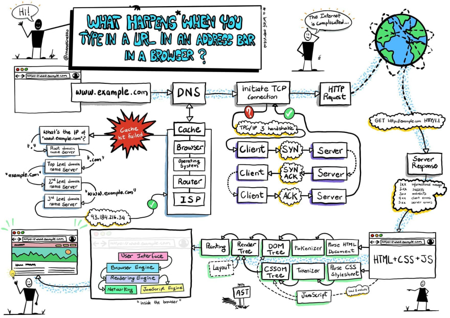

# Proyecto de extensión del navegador Parte 1: Todo sobre los navegadores


> Sketchnote de [Wassim Chegham](https://dev.to/wassimchegham/ever-wondered-what-happens-when-you-type-in-a-url-in-an-address-bar-in-a-browser-3dob)

## [Pre-lecture prueba](https://ff-quizzes.netlify.app/web/quiz/23)

### Introducción:

Las extensiones de navegador agregan funcionalidad adicional a un navegador. Pero antes de crear uno, debe aprender un poco sobre cómo funcionan los navegadores.

### Acerca del navegador:

En esta serie de lecciones, aprenderá a crear una extensión de navegador que funcione en los navegadores Chrome, Firefox y Edge. En esta parte, descubrirá cómo funcionan los navegadores y distribuirá los elementos de la extensión del navegador.

Pero, ¿qué es exactamente un navegador? Es una aplicación de software que permite al usuario final acceder al contenido de un servidor y mostrarlo en páginas web.

✅ Un poco de historia: el primer navegador se llamó 'WorldWideWeb' y fue creado por Sir Tim Berners-Lee en 1990.

! [navegadores iniciales](images / earlybrowsers.jpg)
> Algunos de los primeros navegadores, a través de [Karen McGrane](https://www.slideshare.net/KMcGrane/week-4-ixd-history-personal-computing)

Cuando un usuario se conecta a Internet usando una dirección URL (Localizador uniforme de recursos), generalmente usando el Protocolo de transferencia de hipertexto a través de una dirección `http` o` https`, el navegador se comunica con un servidor web y busca una página web.

En este punto, el motor de renderizado del navegador lo muestra en el dispositivo del usuario, que puede ser un teléfono móvil, una computadora de escritorio o una computadora portátil.

Los navegadores también tienen la capacidad de almacenar en caché el contenido para que no sea necesario recuperarlo del servidor cada vez. Pueden registrar el historial de la actividad de navegación de un usuario, almacenar 'cookies', que son pequeños fragmentos de datos que contienen información que se utiliza para almacenar la actividad de un usuario, y más.

Una cosa realmente importante para recordar acerca de los navegadores es que no todos son iguales. Cada navegador tiene sus fortalezas y debilidades, y un desarrollador web profesional debe comprender cómo hacer que las páginas web funcionen bien en todos los navegadores. Esto incluye el manejo de pequeñas ventanas gráficas, como las de un teléfono móvil, así como de un usuario sin conexión.

Un sitio web realmente útil que probablemente debería marcar en cualquier navegador que prefiera usar es [caniuse.com](https://www.caniuse.com). Cuando está creando páginas web, es muy útil utilizar las listas de tecnologías compatibles de caniuse para que pueda ayudar mejor a sus usuarios.

✅ ¿Cómo puede saber qué navegadores son los más populares entre la base de usuarios de su sitio web? Verifique sus análisis: puede instalar varios paquetes de análisis como parte de su proceso de desarrollo web, y le dirán qué navegadores son los más utilizados por los diversos navegadores populares.

## Extensiones de navegador

¿Por qué querrías crear una extensión de navegador? Es muy útil adjuntarlo a su navegador cuando necesita acceso rápido a tareas que tiende a repetir. Por ejemplo, si necesita comprobar los colores en las distintas páginas web con las que interactúa, puede instalar una extensión de navegador de selector de color. Si tiene problemas para recordar las contraseñas, puede utilizar una extensión de navegador de administración de contraseñas.

Las extensiones de navegador también son divertidas de desarrollar. Suelen gestionar un número finito de tareas que realizan bien.

✅ ¿Cuáles son sus extensiones de navegador favoritas? ¿Qué tareas realizan?

### Instalando extensiones

Antes de empezar a crear, observe el proceso de creación e implementación de una extensión de navegador. Si bien cada navegador varía un poco en la forma en que administran esta tarea, el proceso es similar en Chrome y Firefox a este ejemplo en Edge:


En esencia, el proceso será:

- construye tu extensión usando `npm build`
- navegue en el navegador hasta el panel de extensiones usando el icono `...` en la parte superior derecha
- si se trata de una nueva instalación, elija `load unpacked` para cargar una nueva extensión desde su carpeta de compilación (en nuestro caso es `/ dist`)
- o haga clic en `recargar` si está recargando la extensión ya instalada

✅ Estas instrucciones pertenecen a extensiones que usted mismo construye; para instalar extensiones que se han lanzado a la tienda de extensiones del navegador asociada a cada navegador, debe navegar a esas [tiendas](https://microsoftedge.microsoft.com/addons/Microsoft-Edge-Extensions-Home) e instalar la extensión de tu elección.


### Empezar

Vas a crear una extensión de navegador que muestre la huella de carbono de tu región, mostrando el uso de energía de tu región y la fuente de energía. La extensión tendrá un formulario que recopila una clave API para que pueda acceder
API de CO2 Signal.

**Necesitas:**

- [una clave API](https://www.co2signal.com/); ingrese su correo electrónico en el cuadro de esta página y se le enviará uno
- el [código de su región](http://api.electricitymap.org/v3/zones) correspondiente al [Mapa de electricidad](https://www.electricitymap.org/map) (en Boston, por ejemplo, Yo uso 'US-NEISO').
- el [código de inicio](../inicio). Descargue la carpeta `start`; completará el código en esta carpeta.
- [NPM](https://www.npmjs.com) - NPM es una herramienta de gestión de paquetes; instálelo localmente y los paquetes enumerados en su archivo `package.json` se instalarán para que los use su recurso web

✅ Obtenga más información sobre la administración de paquetes en este [excelente módulo de aprendizaje](https://docs.microsoft.com/learn/modules/create-nodejs-project-dependencies/?WT.mc_id=academic-77807-sagibbon)

Tómate un minuto para revisar el código base:

dist
     - | manifest.json (los valores predeterminados se establecen aquí)
     - | index.html (marcado HTML de front-end aquí)
     - | background.js (JS de fondo aquí)
     - | main.js (JS construido)
src
     - | index.js (su código JS va aquí)

✅ Una vez que tenga a mano su clave API y el código de región, guárdelos en algún lugar en una nota para uso futuro.

### Construye el HTML para la extensión

Esta extensión tiene dos vistas. Uno para recopilar la clave API y el código de región:


Y el segundo para mostrar el uso de carbono de la región:


Comencemos por construir el HTML para el formulario y darle estilo con CSS.

En la carpeta `/dist`, creará un formulario y un área de resultados. En el archivo `index.html`, complete el área delineada del formulario:


```HTML
<form class="form-data" autocomplete="on">
	<div>
		<h2>¿Nuevo? Agrega tu información</h2>
	</div>
	<div>
	<label>Nombre de la región</label>
		<input type="text" required class="region-name" />
	</div>
	<div>
		<label>Tu clave API de tmrow</label>
		<input type="text" required class="api-key" />
	</div>
	<button class="search-btn">Enviar</button>
</form>	
```
Este es el formulario donde se ingresará la información guardada y se guardará en el almacenamiento local.

A continuación, cree el área de resultados; debajo de la etiqueta de formulario final, agregue algunos divs:

```HTML
<div class="result">
	<div class="loading">cargando...</div>
	<div class="errors"></div>
	<div class="data"></div>
	<div class="result-container">
		<p><strong>Región: </strong><span class="my-region"></span></p>
		<p><strong>Uso de carbono: </strong><span class="carbon-usage"></span></p>
		<p><strong>Porcentaje de combustible fósil: </strong><span class="fossil-fuel"></span></p>
	</div>
	<button class="clear-btn">Cambia región</button>
</div>
```
En este punto, puede probar una compilación. Asegúrese de instalar las dependencias del paquete de esta extensión:

```
npm install
```

Este comando usará npm, el Node Package Manager, para instalar el paquete web para el proceso de compilación de su extensión. Webpack es un paquete que maneja la compilación de código. Puede ver el resultado de este proceso mirando en `/dist/main.js`; verá que el código se ha incluido.

Por ahora, la extensión debería compilarse y, si la implementa en Edge como una extensión, verá un formulario claramente mostrado.

Felicitaciones, ha dado los primeros pasos para crear una extensión de navegador. En lecciones posteriores, lo hará más funcional y útil.

🚀Challenge: Eche un vistazo a una tienda de extensiones de navegador e instale una en su navegador. Puede examinar sus archivos de formas interesantes. ¿Qué descubres?


## [Post-lecture prueba](https://ff-quizzes.netlify.app/web/quiz/24)

## Revisión y autoestudio

En esta lección aprendió un poco sobre la historia del navegador web; Aproveche esta oportunidad para aprender cómo los inventores de la World Wide Web imaginaron su uso leyendo más sobre su historia. Algunos sitios útiles incluyen:

[La historia de los navegadores web](https://www.mozilla.org/firefox/browsers/browser-history/)

[Historia de la Web](https://webfoundation.org/about/vision/history-of-the-web/)

[Una entrevista con Tim Berners-Lee](https://www.theguardian.com/technology/2019/mar/12/tim-berners-lee-on-30-years-of-the-web-if-we-dream-a-little-we-can-get-the-web-we-want)

**Tarea**: [Cambia el estilo de tu extensión](assignment.md)

